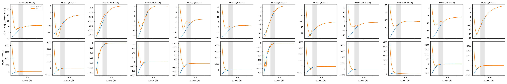

# NH3 + CH capture PES: exploratory Flaxy fit

20 November 2026. Data-only fit; no new electronic-structure calculations.

## Summary
- **Long range works.** The fitted tail gives a dipole–dipole coefficient of −0.333 ± 0.004 a.u., against −μ(NH3)μ(CH) ≈ −0.33 a.u. from experimental dipoles, with the right sign (C⁻H⁺). The fit residual at 9–12 Å (300 K) is 1.5 cm⁻¹. Beyond 7 Å the surface is purely this physical tail, so it holds where 10 K capture is decided (15–30 Å).
- **The kernel model (S3-symmetric kernel ridge regression) works and is data-limited.** On the in-range validation set the RMSE is 225 cm⁻¹ (0.64 kcal/mol), and 114 cm⁻¹ for 0–10 kcal/mol. The training error is 42 cm⁻¹. The validation error keeps falling as data are added (roughly ∝ N^−0.4), with no plateau.
- **The tensor train (the Flaxy core) is not competitive with this much data.** Fitted to the energies it reaches 1,200–1,600 cm⁻¹; trained on kernel predictions it reaches 660 cm⁻¹.
- **Data gap.** Only about 70 fitting geometries lie below the NH3 + CH limit, i.e. in the capture funnel and the H3N–CH well.

## Data and split
- 13,422 geometries in 4 files: 1.5–4.5 Å and 4.5–12 Å centre-of-mass distance R, each at 300 K and 1500 K normal-mode sampling, with 15 R shells per file. Label: `E_Bps` (MRCC hybrid method).
- Validation: 300 geometries per file, 20 per R shell, fixed seed (`splits/validation_seed20261120.json`).
- Energy domain (user decision): geometries more than 200 kJ/mol above the NH3 + CH limit are not fitted.
  - Reference: lowest sampled point at R ≥ 9 Å, −94.91683379 Eh. This is 4.1 kJ/mol above the relaxed limit (−94.91839384 Eh) found on the fitted surface, so the effective cut was about 204 kJ/mol.

| | count |
|---|---:|
| training, in range | 7,856 |
| validation, in range | 824 |
| validation, above the cut (extrapolation check only) | 376 |

- What the cut removed:
  - Below R = 2.0 Å, 1,171 of 1,499 geometries, which are random-orientation clashes 272–2,677 kJ/mol (median 526) above the complex.
  - The lowest sampled complex energy is −71.5 kJ/mol relative to the limit, at R = 1.71 Å.

## Model
V = d + U_NH3(q_A) + U_CH(r) + L_damp(R, Ω, q) + (1 − g(R)) f_S3(y)

| Part | Choice |
|---|---|
| Monomers | NH3: degree-8 polynomial in Morse variables, invariant under the 6 swaps of its hydrogens (S3 orbit sums, 589 terms). CH: degree-8 polynomial. |
| Tail | Multipole-shaped terms: R⁻³ dipole–dipole (plus 2 terms for monomer stretch), R⁻⁴ dipole–quadrupole ×2, R⁻⁵ quadrupole–quadrupole, R⁻⁶ isotropic + 2 anisotropic. Built from bond vectors, so no singularity for planar NH3. Tang–Toennies damping, β = 1.0 bohr⁻¹. |
| Fit | Two stages. (1) All terms on 300 K, R ≥ 9 Å; keep the tail. (2) Monomers on R ≥ 7 Å with the tail frozen. |
| Switch | C² quintic step in R between R_in = 5 Å and R_out = 7 Å. Beyond 7 Å, V equals the baseline exactly. |
| f_S3 | Short-range correction, exactly symmetric under the hydrogen swaps (S3). Kernel: Matérn-5/2 on y = exp(−r/a) for the 15 pair distances (a = 1.5/2.0/1.5 bohr for NH/HH/CH, 4.0 bohr between molecules), length 0.8, ridge 10⁻⁶, energies only. Tensor train: Gaussian dictionaries per pair. |
| Weights | Provisional Bowman-type, ΔE = 10 kcal/mol (TODO in `src/flaxy/weights.py`). |

Forces are analytic everywhere. The tests (15, pytest) check:
- forces against Richardson finite differences, including inside the switch;
- energy invariance under the hydrogen swaps and rigid motion;
- zero net force and torque;
- V = baseline beyond R_out, bit for bit;
- save/load round trip.

## Long range

Fitted tail coefficients (a.u., ± standard error):

| Term | dd | dq | qd | qq | c6 | c6a | c6b | ddA | ddB |
|---|---|---|---|---|---|---|---|---|---|
| Coefficient | −0.3328 ± 0.0036 | −0.154 ± 0.024 | −0.680 ± 0.025 | −0.75 ± 0.15 | −343 ± 36 | 240 ± 60 | 251 ± 57 | 0.034 ± 0.006 | 0.391 ± 0.028 |

- dd is pinned down. The R⁻⁶ terms are poorly identified because the fit window spans only 9–12 Å. That matters little at 10 K.
- Relaxed monomers on the fitted surface: r(NH) = 1.012 Å, r(CH) = 1.120 Å, essentially the experimental equilibrium values.
- Monomer misfit is the accuracy floor at long range: about 4 cm⁻¹ at 300 K and 12 cm⁻¹ over the whole range.

Validation RMSE in the 4.5–12 Å files (full model):

| | 300 K | 1500 K |
|---|---:|---:|
| all shells | 8.2 cm⁻¹ | 35.3 cm⁻¹ |

- Per shell at 300 K: about 22 cm⁻¹ at 4.5 Å, 12 cm⁻¹ at 5.0 Å, 3–8 cm⁻¹ beyond 6 Å.
- The switch was moved from 6–9 Å to 5–7 Å. With 6–9 Å, wiggles in the kernel model added up to about 20–26 cm⁻¹/Å of spurious radial force, which is comparable to the true dipole–dipole force there.


*Rigid radial cuts of 300 K validation geometries. Top: R³[V − V∞]. Bottom: −dV/dR. Grey band: the switch. Blue: baseline only. Orange: full kernel surface.*

## Short range: kernel model (reference surface)
`runs/krr_sw_5.0_7.0/surface_krr.npz`

| In-range validation | n | RMSE (cm⁻¹) |
|---|---:|---:|
| all | 824 | **225.5** (0.645 kcal/mol; MAE 77.8) |
| file R1.5–4.5, 300 K | 249 | 260.5 |
| file R1.5–4.5, 1500 K | 135 | 428.7 |
| E_rel < 0 kcal/mol | 3 | 469 |
| E_rel 0–10 kcal/mol | 352 | 113.9 |
| E_rel 10–30 kcal/mol | 252 | 224.6 |
| E_rel 30–48 kcal/mol | 217 | 332.3 |

- **Where the error is.** The error concentrates at R < 2.5 Å, in the adduct region, where few geometries are in range. The baseline alone gives 2,051 cm⁻¹ here, so the kernel removes about 90% of the error.
- **Learning curve** (validation, R < 7 Å):

| training geometries | 743 | 1,486 | 2,973 | 5,947 |
|---|---:|---:|---:|---:|
| RMSE (cm⁻¹) | 602 | 444 | 348 | 254 |

  Each doubling of the data cuts the error by about 25%.
- **Holes.** On the 376 held-out geometries above the cut, 5 are predicted below 200 kJ/mol, one at 15 kJ/mol where the reference is 350. Beyond the data the short-range correction fades to zero and the baseline has no repulsive wall.
- **Speed.** Batched energies take 1.6 ms per geometry inside 7 Å and 0.28 ms outside (NumPy).

## Short range: tensor train
These numbers are on the internal tuning split (700 geometries). The kernel model scores 279 cm⁻¹ on the same split.

| Variant | Parameters | Tuning RMSE (cm⁻¹) |
|---|---:|---:|
| Rank 6, fitted to the energies | ~3k | 1,170–1,580 |
| Rank 12, fitted to the energies | 10,440 | 2,644 (overfits; training 140 cm⁻¹) |
| Rank 8, trained on data + 23.6k kernel-labelled perturbed geometries | 4,872 | 659 (678 vs the kernel teacher) |

- **Why it struggles.**
  - Averaging the tensor train over the 6 hydrogen swaps, combined with the ridge, picks the fully symmetrized representative, whose rank is up to 6× higher.
  - Each site's Gaussian features know nothing about the other 14 coordinates, so between sparse data points the train is unconstrained.
  - So with about 5k energies in 15 dimensions it either underfits or overfits.
- **Fixes made along the way:**
  - whitened per-site features;
  - SVD truncation measured on the data;
  - a one-site repair solve after each truncation;
  - an update is kept only if the training loss doesn't rise.
- Trained on kernel predictions (dense labels), the error halves. The remaining gap to the kernel is compression error at rank 8.

## Conclusions
1. The method is usable for 10 K capture trajectories: physical long range, analytic forces, exact symmetry. Once it has more data and a repulsive wall, the kernel version is a usable production route.
2. The tensor train is not yet a substitute for the kernel. At best it can become a faster stand-in for the kernel model, with accuracy capped by the kernel's.

## Recommendations
**Data**
- Targeted short-range sampling, a few thousand geometries below 200 kJ/mol:
  - the approach path, e.g. constrained optimizations at fixed R from about 4 Å down to 1.5 Å with the N lone pair towards C;
  - normal-mode samples around these points and around the H3N–CH minimum.
- Isolated NH3 and CH single points at the same MRCC level, a few thousand distorted monomers each. These remove the monomer-misfit floor at long range. This requires the method to be size-consistent.
- Gradients, if the MRCC hybrid method provides them: each geometry then gives 18 more labels.
- No more long-range dimer data are needed.

**Model**
- Add a pairwise repulsive wall to the baseline.
- Use the relaxed NH3 + CH limit as the energy reference (fit twice).
- Set the in-range weighting function (`src/flaxy/weights.py`).

**Scaling**
- A sparse (inducing-point) kernel model beyond about 20–30k points.
- Tensor-train distillation at ranks 12–16 for speed.
- A tensor train on permutation-invariant inputs as a research option.

**Physics**
- CH(X²Π) is doubly degenerate. The scalar surface follows the state the electronic-structure method converged to. Check this before interpreting state-resolved capture.

## Reproduce
```bash
venv                                     # ~/.venvs/science
python -m pytest -q                      # 15 tests
python scripts/fit_capture.py --out runs/krr_sw_5.0_7.0 --models krr --krr-lengths 0.8
python scripts/plot_cuts.py runs/krr_sw_5.0_7.0/surface_krr.npz --n-cuts 12
```
- Code: `src/flaxy/`
- Design notes and the full log of findings: `docs/superpowers/specs/2026-11-20-nh3-ch-capture-fit-design.md`
