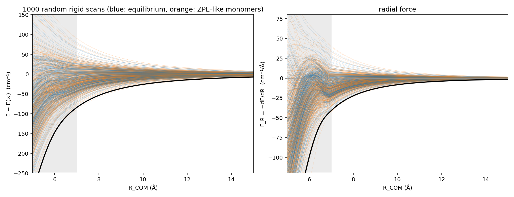
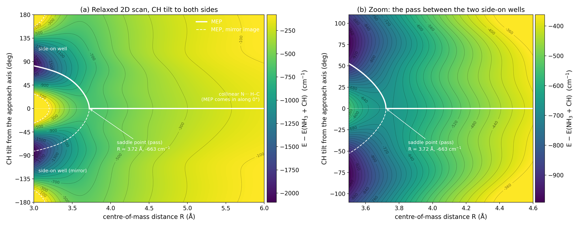
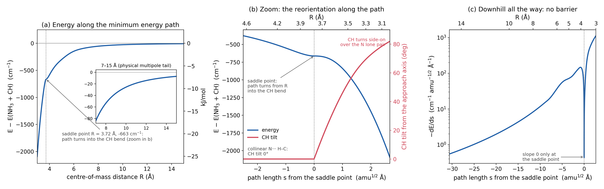

# NH₃ + CH capture PES: current best fit (2026-11-23)

This is a full-dimensional NH₃ + CH surface for capture dynamics at low temperature (about 10–20 K). It fits MRCC energies (`E_Bps`) up to 120 kJ/mol above the NH₃ + CH dissociation limit.

- **Surface file:** `runs/lowE_all6_cut120/surface_krr.npz`. It is local only, because `runs/` is not in git.
- **Loading:** `Surface.load(...)` loads it and gives energies, forces and Hessians.

## Summary
- **Overall error:** 187 cm⁻¹ (2.2 kJ/mol) on 1,072 validation points inside the fit domain.
- **Long range (7–12 Å):** 4–5 cm⁻¹, and the tail is physical: the fitted dipole–dipole coefficient is within 4% of the value from experimental dipoles.
- **Smoothness:** the surface is twice continuously differentiable everywhere. In 1,000 rigid approach scans from 15 Å there are no kinks, and beyond 7 Å no maxima other than those of the physical tail.
- **Barrierless capture:**
  - The minimum energy path comes in collinear, H₃N···H–C, down to a saddle at R = 3.72 Å (−663 cm⁻¹).
  - From there CH turns side-on into the H₃N–CH adduct well.
  - The path goes downhill everywhere.

## 1. Data

**Source.**
- Energies: MRCC energies (`E_Bps`).
- Geometries: centre-of-mass (COM) scans of NH₃ + CH with normal-mode displacements of both molecules, sampled at 300 K or 1500 K.
- Validation: 300 geometries per file, spread evenly over the R shells, are held out and never used in the fit (`splits/validation_seed20261120.json`).

**Fit domain.** E_rel < 120 kJ/mol above the dissociation reference.
- The reference is E = −94.91683379 Eh, the lowest training energy at R ≥ 9 Å. It lies 4.1 kJ/mol above the relaxed NH₃ + CH limit.
- 120 kJ/mol still covers every geometry a trajectory with zero-point energy can reach. The harmonic ZPE of NH₃ + CH is about 107 kJ/mol.

| file | sampling | R range (Å) | geometries | below 120 kJ/mol | training | validation | in short-range model |
|---|---|---|---:|---:|---:|---:|---:|
| R1.5_to_4.5_1500K | 1500 K | 1.5–4.5 | 3,971 | 380 | 346 | 34 | 346 |
| R1.5_to_4.5_300K | 300 K | 1.5–4.5 | 2,639 | 2,038 | 1,798 | 240 | 1,798 |
| R1.5_to_5.0_300K | 300 K | 1.5–5.0 | 5,118 | 3,837 | 3,601 | 236 | 3,601 |
| R1.5_to_5.0_300K_another | 300 K | 1.5–5.0 | 3,423 | 2,545 | 2,312 | 233 | 2,312 |
| R4.5_to_12.0_1500K | 1500 K | 4.5–12.0 | 4,048 | 520 | 491 | 29 | 135 |
| R4.5_to_12.0_300K | 300 K | 4.5–12.0 | 2,764 | 2,764 | 2,464 | 300 | 718 |
| **total** | | | **21,963** | **12,084** | **11,012** | **1,072** | **8,910** |

The short-range model only sees training points with R < 7 Å, because the switch removes it beyond 7 Å.

## 2. Model

```
V(x) = U(x) + [1 − g(R)] · f(Z(x))        R = NH₃–CH centre-of-mass distance
U    = d + U_NH3(q_NH3) + U_CH(r_CH) + L(R, orientation, q)
```

### 2.1 Monomer polynomials U_NH3, U_CH
- **Variables:** Morse variables y = exp(−r/a). The range is a = 1.5 bohr for the N–H and C–H bonds and a = 2.0 bohr for the H–H distances in NH₃.
- **NH₃:** all 6 distances, total degree ≤ 8. The polynomial is invariant under the 6 permutations of the H atoms. That gives 3,002 monomials, which combine into **589 invariant terms**.
- **CH:** 1 distance, degree 1–8, so **8 terms**.

### 2.2 Long-range tail L
Each term is an orientation shape times a damped inverse power, `c · shape · f_n(βR) / Rⁿ`.

**Damping.** Tang–Toennies, `f_n(βR) = 1 − exp(−βR) Σ_{k=0..n} (βR)^k / k!`, with β = 1.0 bohr⁻¹.

**Fragment vectors and tensors.** Everything is measured from each fragment's centre of mass, and n is the unit vector from NH₃ to CH.
- **Dipole directions:**
  - NH₃: v_A = Σ_H (r_H − o_A) / 1.899 bohr;
  - CH: v_B = (r_H − o_B) / 1.943 bohr.
  - The scales are the median norms over the training geometries, so |v| ≈ 1 for a typical geometry.
- **Quadrupole shapes:** Q_F = Σ_i (s_i s_iᵀ − |s_i|² I/3) / l_F², with l = 1.635 bohr for NH₃ and 1.379 bohr for CH.

**Coefficients.** All values are in atomic units (Eh bohrⁿ), with standard errors from the fit.

| term | shape | power n | coefficient c | ± |
|---|---|---:|---:|---:|
| dd | 3(v_A·n)(v_B·n) − v_A·v_B | 3 | −0.3463 | 0.0033 |
| dq | 15(v_A·n)(n·Q_B·n) − 6 v_A·Q_B·n | 4 | −0.0840 | 0.0122 |
| qd | 15(v_B·n)(n·Q_A·n) − 6 v_B·Q_A·n | 4 | −0.4381 | 0.0157 |
| qq | 105(n·Q_A·n)(n·Q_B·n) − 60 (Q_A n)·(Q_B n) + 6 Q_A:Q_B | 5 | −0.2510 | 0.0447 |
| c6 | 1 (isotropic) | 6 | −334.6 | 35.1 |
| c6a | n·Q_A·n (NH₃ anisotropy) | 6 | 160.1 | 36.9 |
| c6b | n·Q_B·n (CH anisotropy) | 6 | 130.0 | 27.5 |
| flexA | dd · (\|v_A\|² − 1), NH₃ dipole change with distortion | 3 | 0.0375 | 0.0066 |
| flexB | dd · (\|v_B\|² − 1), CH dipole change with distortion | 3 | 0.4006 | 0.0279 |

**How to read the coefficients.**
- **dd:** since |v| ≈ 1, the dd coefficient is −μ(NH₃)·μ(CH) = 0.346 a.u. The experimental dipoles (1.47 D and 1.46 D) give 0.332 a.u.; the earlier fit up to 200 kJ/mol gave 0.333.
- **All other coefficients are effective.** They multiply normalized shapes, not physical multipole moments.
- **c6** collects every R⁻⁶ contribution in the 9–12 Å fit window: dispersion, induction and residual overlap.

### 2.3 Fit of U
Both stages are linear weighted least squares, solved by SVD.

| stage | what is fitted | data | points | parameters | RMSE |
|---|---|---|---:|---:|---:|
| 1 | constant + both polynomials + tail | 300 K, R ≥ 9 Å | 1,049 | 607 | 1.43 cm⁻¹ |
| 2 | constant + both polynomials, tail kept from stage 1 | R ≥ 7 Å | 2,102 | 598 | 4.35 cm⁻¹ |

Only the tail is kept from stage 1.

### 2.4 Switching function g(R)
`g(R) = 10x³ − 15x⁴ + 6x⁵`, with `x = (R − R_in)/(R_out − R_in)` clipped to [0, 1].
- R is the centre-of-mass distance, with R_in = 5.0 Å and R_out = 7.0 Å.
- The short-range model enters with the factor s = 1 − g. That factor is 1 below 5 Å, falls to 0 at 7 Å, and its first and second derivatives vanish at both ends.
- Beyond 7 Å the surface is exactly U.

### 2.5 Short-range model f
- **Inputs Z: 219 permutation-invariant polynomials (PIPs).**
  - They are orbit sums of Morse monomials of all 15 interatomic distances, with total degree ≤ 3, from 815 monomials.
  - They are invariant under the 6 permutations of the NH₃ hydrogens, so the symmetry is built into the inputs.
  - Morse ranges: a = 1.5 bohr for bonds, 2.0 bohr for H–H in NH₃, and 4.0 bohr for all 8 intermolecular distances.
  - Each PIP is standardized to zero mean and unit variance over the training set.
- **Kernel ridge regression.**
  - The model is f(Z) = Σ_t β_t k(Z, Z_t) with a Matérn-5/2 kernel, length scale ℓ = 64 in standardized PIP units, and ridge λ = 10⁻⁶.
  - There are 8,910 centres, the training points with R < 7 Å.
  - It is fitted to the residual E − U with the switch included in the operator: `(S K S + λ W⁻¹) α = E − U`, with `β = S α` and `S = diag(1 − g)`.
- **Weights:** w = 10 / (10 + max(E_rel, 0)), with E_rel in kcal/mol. This is a Bowman-type weight with ΔE = 10 kcal/mol, and is provisional.
- **Length scale:** chosen on a 12% tuning subset of the training data.

  | ℓ | 4 | 8 | 16 | 32 | **64** | 128 |
  |---|---:|---:|---:|---:|---:|---:|
  | tune wRMSE (cm⁻¹) | 660 | 515 | 403 | 327 | **284** | 297 |

### 2.6 Properties
- **Exact permutation invariance**, with analytic forces and analytic Hessians.
- **Twice continuously differentiable everywhere:** in the tail, the switch and the Matérn-5/2 kernel.
- **Parameters:** 607 in U and 8,910 kernel coefficients.
- **Cost:** about 0.6 ms per energy + forces inside 7 Å, where the kernel is active; much less outside.

## 3. Accuracy

The training RMSE is 85 cm⁻¹ and the validation RMSE is 187 cm⁻¹ (2.24 kJ/mol). The table below groups the validation points (all inside the 120 kJ/mol domain) by centre-of-mass distance. The last column, |E_int|, is the typical size of the interaction energy at that distance (the median of E − U_NH3 − U_CH).

| R (Å) | validation points | training points | RMSE (cm⁻¹) | RMSE (kJ/mol) | MAE (cm⁻¹) | max (cm⁻¹) | typical \|E_int\| (cm⁻¹) |
|---|---:|---:|---:|---:|---:|---:|---:|
| 1.5–2.5 | 106 | 1,255 | 534 | 6.38 | 380 | 2,064 | 2,466 |
| 2.5–3.0 | 137 | 1,550 | 206 | 2.47 | 146 | 763 | 1,011 |
| 3.0–3.5 | 118 | 1,113 | 87 | 1.04 | 63 | 371 | 418 |
| 3.5–4.0 | 135 | 1,452 | 46 | 0.55 | 33 | 256 | 218 |
| 4.0–4.5 | 161 | 1,664 | 46 | 0.54 | 27 | 383 | 132 |
| 4.5–5.0 | 99 | 1,046 | 16 | 0.20 | 13 | 55 | 63 |
| 5.0–6.0 | 55 | 449 | 19 | 0.23 | 15 | 59 | 58 |
| 6.0–7.0 | 42 | 374 | 10 | 0.12 | 8 | 29 | 32 |
| 7.0–9.0 | 88 | 831 | 4.3 | 0.05 | 3 | 16 | 12 |
| 9.0–12.0 | 131 | 1,271 | 5.0 | 0.06 | 3 | 36 | 7 |
| **all** | **1,072** | **11,012** | **187** | **2.24** | **74** | **2,064** | |

The same validation points grouped by energy:

| E_rel (kJ/mol) | < 0 | 0–20 | 20–40 | 40–80 | 80–120 |
|---|---:|---:|---:|---:|---:|
| validation points | 10 | 126 | 440 | 401 | 95 |
| RMSE (cm⁻¹) | 258 | 222 | 113 | 164 | 389 |

**Notes on the accuracy.**
- **Beyond 7 Å, most of the error is the NH₃/CH distortion misfit** (4.4 cm⁻¹ in stage 2). That part depends only on the internal coordinates of each molecule, so it exerts no force between the molecules.
- **The 5–7 Å switch region has the least data:** 449 and 374 training points per Å.
- **Effect of the data and the domain:**
  - Adding the two low-energy 300 K files lowered the error by about 15%.
  - Restricting the fit to 120 kJ/mol lowered it from 222 to 187 cm⁻¹ on the same points.

## 4. Smoothness: rigid approach scans

**Setup.**
- Both molecules are rigid, and CH moves along the centre-of-mass axis from 15 Å to 3 Å in 0.01 Å steps.
- There are 1,000 random relative orientations: half with equilibrium monomers, half with ZPE-like monomer geometries from the 300 K data.
- Energies are relative to the same monomers at infinity, and the radial forces are analytic.



*Energy (left) and radial force −dE/dR (right) along the 1,000 rigid scans. Blue: equilibrium monomers; orange: ZPE-like monomers. Black: lowest energy over orientations. Grey band: the 5–7 Å switch.*

**What the scans show.**
- **No kinks.** The second differences of the radial force show no spike at the switch edges: at most 0.10 cm⁻¹/Å at 5 Å and 0.05 cm⁻¹/Å at 7 Å, against 0.08 cm⁻¹/Å inside the switch.
- **Beyond 7 Å, every local maximum is a maximum of the physical tail.** They occur in orientations where the dipoles repel and dispersion takes over at shorter R. Typical sizes are 1.9 cm⁻¹ (median) at 7–10 Å and 0.2 cm⁻¹ at 10–15 Å.
- **Small wiggles in the 4.5–7 Å switch region.**
  - On 128 of the 1,000 scans the short-range model adds a new small maximum: median 1.5 cm⁻¹, largest 15 cm⁻¹, and 72% of them lie below the dissociation limit.
  - On 162 scans with repulsive orientations it makes an existing tail maximum taller, by a median of 12 cm⁻¹ and at most 72 cm⁻¹.
  - None of these lies on the capture path.

## 5. Minimum energy path

**Method.**
- A relaxed 2D scan over R = 3–6 Å and CH tilt 0–180°, with the monomers rigid at equilibrium. At every point the NH₃ orientation (3 angles) and the CH azimuth are optimized.
- The MEP is the steepest-descent path on this surface in mass-weighted coordinates (√μ·R and √I_CH·tilt, with μ = 7.374 amu and I_CH = 1.165 amu Ų).
- Above 6 Å the path continues along the collinear channel to 15 Å.
- CH tilt is the angle between the H→C axis and the approach axis: 0° means the H end points at NH₃, about 80° is side-on, 180° means the C end points at NH₃.



*Relaxed 2D scan with the tilt mirrored to −180°…180°. The two halves are equivalent, because CH can tilt to either side. White: the MEP and its mirror image. The collinear valley runs along 0°, and the saddle point is the pass between the two side-on wells.*



*(a) Energy along the MEP against R; the inset shows the 7–15 Å multipole tail. (b) Zoom on the reorientation, plotted against the mass-weighted path length s, with s = 0 at the saddle: energy and CH tilt. (c) Slope along the whole path: downhill everywhere, and zero only at the saddle.*

| R (Å) | 15 | 9 | 7 | 6 | 5 | 4.0 | 3.72 (saddle) | 3.0 |
|---|---:|---:|---:|---:|---:|---:|---:|---:|
| E (cm⁻¹) | −7 | −36 | −84 | −147 | −300 | −586 | −663 | −2,094 |
| CH tilt (°) | 0 | 0 | 0 | 0 | 0 | 0 | 0 | ≈80 |

**What the path shows.**
- **From 15 Å down to 3.72 Å the MEP is collinear** (N lone pair ··· H–C). This is the head-to-tail arrangement of the two dipoles.
- **At R = 3.72 Å it reaches a saddle point,** at E = −663 cm⁻¹ (−7.9 kJ/mol):
  - along R it is a minimum (d²E/dR² = +3,505 cm⁻¹/Ų);
  - along the CH tilt it is a maximum (−192 cm⁻¹/rad²).
- **From the saddle the path turns side-on.** The N lone pair donates into the empty CH π orbital, which leads toward the H₃N–CH adduct. The tilt reaches 45° at 3.56 Å and about 80° at 3.0 Å.
- **There is no barrier:** the energy decreases along the whole path.
- **A side-on valley also exists below 4.4 Å.** Below 4.0 Å it is lower than the collinear one, but a 20–30 cm⁻¹ ridge separates them. Trajectories, which have gained hundreds of cm⁻¹ of kinetic energy by then, cross it easily.

## 6. Open issues
- **Short-range accuracy below 3.5 Å:** 87–534 cm⁻¹. More data, or a model whose cost does not grow with the data (a PIP neural network), would help.
- **Data density at 5–7 Å,** in the switch region.
- **The CH(X²Π) degeneracy.**
  - On the collinear (C₃ᵥ) line the two CH π components are degenerate, so the true lower adiabatic surface probably has a conical-intersection cusp there.
  - A smooth fit cannot reproduce that cusp. MRCC points at bends of 0–20° for R = 3.5–5 Å would check it.
- **One surface only.** At 20 K the spin–orbit splitting (about 28 cm⁻¹) and the Λ-doubling of CH are comparable to the collision energy.
- **Weights:** the in-domain weighting (`src/weights.py`) is still provisional.

## 7. Reproduce

Run from the repository root with the science virtual environment:

```
python scripts/fit_capture.py --out runs/lowE_all6_cut120 --models krr --ecut-kj 120 --krr-lengths 4 8 16 32 64 128
python scripts/approach_scans.py runs/lowE_all6_cut120/surface_krr.npz        # rigid scans, ~7 min
python scripts/plot_min_path.py  runs/lowE_all6_cut120/surface_krr.npz        # min-path channels, ~6 min
python scripts/mep_2d.py runs/lowE_all6_cut120/surface_krr.npz --r-step 0.05 --tilt-step 3 --procs 16   # 2D scan + MEP, ~21 min
```

- All scan data (`*.dat`, `*.npz`), every figure and copies of the plotting scripts are in `runs/lowE_all6_cut120/scans/`.
- `README_figures.txt` there maps each figure to the script that made it.
